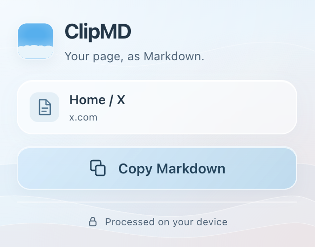

# ClipMD

A small Chrome extension that copies the current page as Markdown.
Open ClipMD, click **Copy Markdown**, and paste wherever you need it.
Conversion runs locally using [Firecrawl's HTML-to-Markdown converter](https://github.com/firecrawl/html-to-markdown), compiled to WebAssembly.



## Install locally

1. Open `chrome://extensions` in Chrome.
2. Turn on **Developer mode** in the top-right corner.
3. Click **Load unpacked** and select this `ClipMD` folder.
4. Pin ClipMD using Chrome's extensions menu.
5. Open a website, click ClipMD, then click **Copy Markdown**.

The WebAssembly module and matching Go runtime are included, so installation needs no build step or API key.
After changing extension files, click **Reload** on its card in `chrome://extensions`.
If you are working in a different checkout or worktree, load that folder as the unpacked extension.

## What gets copied

ClipMD captures a detached copy of the currently loaded page's DOM and converts it into Markdown.
Content added by JavaScript is included once it exists in the DOM.
It preserves headings, links, lists, task checkboxes, tables, emphasis, and code blocks.
Relative links resolve against the document's full base URL, including any `<base>` element.
Image references use the browser's selected image URL or an available `data-src` fallback.
Checkboxes reflect their current checked state.
Scripts, styles, document metadata, templates, and `noscript` content are removed from the copy.
The live page is never modified.

This version keeps navigation and surrounding page text.
It does not automatically select an article or main content region.
Images remain Markdown references; their pixels are not copied or uploaded.
Separate iframe documents, shadow roots, canvas text, PDFs, and office files need separate handling.
Complex merged tables, diagrams, and rendered equations may need additional conversion rules.
Only content present in the DOM at the time of capture is included.
An empty conversion or converter failure leaves the existing clipboard unchanged.

ClipMD works on ordinary HTTP and HTTPS pages.
Chrome's internal pages and the Chrome Web Store cannot be captured.

## Privacy and permissions

Capture, conversion, and copying happen locally.
ClipMD does not send page content to a server or store a copy of it.
Conversion runs in a dedicated worker so the popup stays responsive.
The popup must stay open until copying finishes.

| Permission | Purpose |
| --- | --- |
| `activeTab` | Access the current page after you open ClipMD. |
| `scripting` | Capture a detached copy of the page's current content. |
| `clipboardWrite` | Copy the resulting Markdown to your clipboard. |

The extension's content security policy allows packaged WebAssembly through `wasm-unsafe-eval`.
Scripts and resources remain restricted to the extension itself.

## Converter and builds

The converter is pinned to Firecrawl commit [`1af9901`](https://github.com/firecrawl/html-to-markdown/commit/1af9901a5d6101621120204f7ea3f5355fd5ea31).
It enables the upstream GitHub-Flavored Markdown and robust code-block plugins.
For inline code, it uses the upstream CommonMark rule to preserve spacing and safely handle long backtick sequences.
Full document URL resolution is supplied through the converter's supported options.
There is no Turndown fallback or hosted conversion service.

To rebuild, install Node.js 22+ and Go 1.25+:

```sh
npm ci
npm run build
npm test
```

The first build downloads pinned Go dependencies.
The build compiles `wasm/converter.wasm`, copies `wasm_exec.js` from the same Go installation, and collects third-party licenses.
`wasm/build.json` records dependency versions and hashes of the source files, WASM module, and runtime.
Tests fail if packaged assets become stale after a Go source or dependency change.
Generated assets and license copies should be regenerated with `npm run build`.
The module is approximately 5.6 MB before compression.
First-use startup includes loading and compiling it; performance depends on page size and the device.

## Browser verification

With a recent desktop Google Chrome installed:

```sh
npm run test:browser
```

The browser test launches an isolated temporary regular Chrome profile and a loopback fixture server.
It opens the real toolbar popup and verifies live DOM capture, WASM conversion, clipboard contents, repeated capture, inline-code spacing, and source-page immutability.
It also checks empty pages, protected pages, and recovery when the packaged module is missing.
The test writes sample Markdown and popup screenshots into `test-results/` and replaces the system clipboard with test content.
Native popup automation uses experimental Chrome DevTools Protocol extension commands and was verified in Chrome 154.
Conversion correctness and worker lifecycle are also covered by `npm test`.

## Continuous integration

GitHub Actions runs on pushes and pull requests.
It checks JavaScript syntax, Go formatting and vet results, conversion tests, worker lifecycle tests, and the checked-in WASM asset hashes.
It then rebuilds the converter, checks the rebuilt assets, and runs the native Chrome popup tests on Linux under Xvfb.
Browser screenshots and sample Markdown are available in the `browser-evidence` workflow artifact.

## Third-party licenses

Firecrawl's standalone HTML-to-Markdown library is MIT-licensed.
Its license, the Go runtime license, and dependency licenses are included in `THIRD_PARTY_LICENSES/`.
This extension uses the standalone converter rather than copying code from Firecrawl's main server repository.

## Project structure

- `manifest.json`: extension metadata and permissions.
- `popup.html` and `popup.css`: the popup interface.
- `popup.js`: conversion flow, clipboard writing, and feedback.
- `capture.js`: detached DOM capture and basic cleanup.
- `markdown-converter.js` and `converter-worker.js`: worker messaging and WASM loading.
- `internal/converter/` and `cmd/wasm/`: converter configuration and the Go-to-JavaScript bridge.
- `wasm/`: packaged converter, matching Go runtime, and generated build record.
- `scripts/` and `tests/`: rebuild tooling and verification.
- `icons/`: extension icons and their SVG source.
